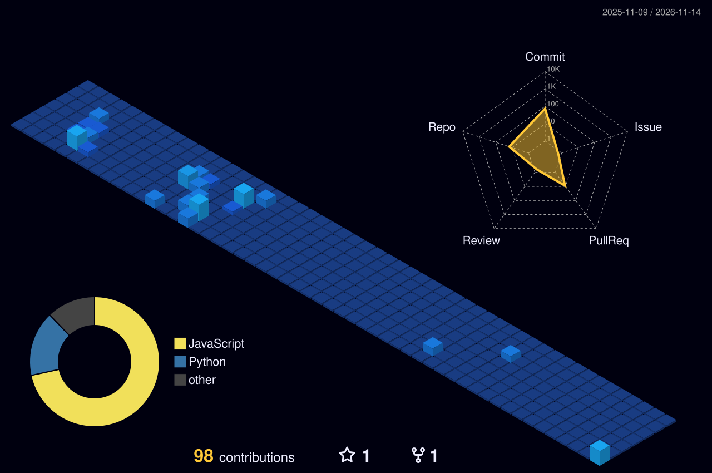
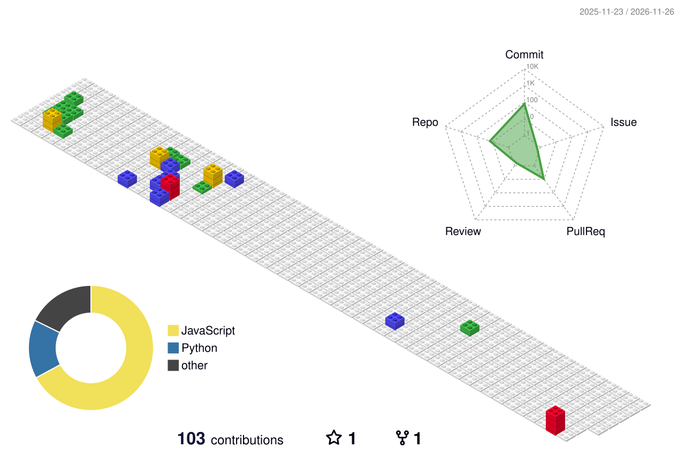

  
  

---

### 🚀 About Me
I engineer systems that bridge low-level hardware with modern cloud & web infrastructure.

- 🔭 **Building:** [SalonPOS](https://github.com/Deepansaravanan/SalonPOS) — a full-stack point-of-sale system, and **Phos & Form**, a custom web design & development studio.
- 🔐 **Research:** Authored **CYPHER-WEAVE**, a 127-byte quantum-inspired lightweight security protocol for 6LoWPAN wireless IoT networks.
- ⚡ **Hardware & Embedded:** Component-level diagnostics, PCB design, Verilog/HDL, and computer vision optical counters.

---

### 🏙️ 3D Contribution Skyline

  

---

### 🛠️ Tech Stack

**Web & Backend**

**Systems, Hardware & Security**

---

### 📈 Live Telemetry & Streak

  

  

